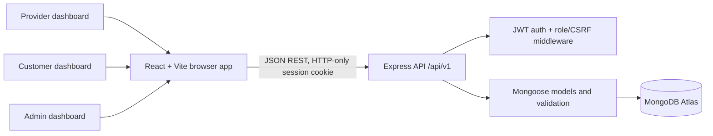
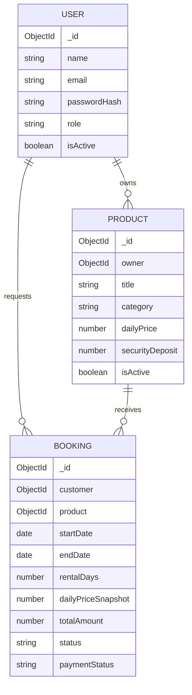

# Rentix

Rentix is a full-stack rental marketplace for sharing consumer goods. Customers can find listings and request rental dates; providers manage listings and respond to requests. The checkout is a clearly labelled demonstration: it records a booking request, but does not collect card data or process money.

## Project abstract

Buying infrequently used equipment can be costly and wasteful, while useful products may sit unused for most of their lifetime. Rentix provides a web marketplace where providers list products and customers request access for a chosen period. A Node.js/Express API validates requests, calculates rental totals, and persists users, listings, and bookings in MongoDB. Role checks protect provider and administrator actions.

## Problem, objectives, and scope

The project demonstrates how a digital rental workflow can make consumer goods easier to access without requiring ownership. Its objectives are to provide searchable listings, secure account sessions, provider listing controls, booking requests with transparent price snapshots, overlap checks when requests are approved, and separate customer/provider/admin screens.

The academic version covers discovery, account registration and login, listing CRUD, booking requests, provider approval/rejection, customer cancellation, and basic administrator statistics and moderation. It does not include real payments, identity verification, messaging, delivery logistics, dispute resolution, or a production review system.

## Architecture



### Database relationships



### Technology choices

- **React and Vite** provide component-based pages and a quick development/build workflow.
- **Node.js and Express** implement a JavaScript REST API with route-level middleware.
- **MongoDB Atlas and Mongoose** store related marketplace records with schemas, validation, timestamps, references, and indexes.
- **JWT in an HTTP-only cookie** avoids exposing the session token to page JavaScript. A CSRF value is returned at sign-in and kept in memory by the client; it is required in a custom header for state-changing requests.
- **bcryptjs** stores password hashes rather than passwords. Helmet, CORS allowlisting, JSON body limits, and rate limiting on registration/login provide additional protections.

## MongoDB collections and relationships

`users` stores a unique email, profile, hashed password, account role, and active flag. Only the `customer` and `provider` roles can be selected during public registration; administrators are provisioned from server-side environment variables.

`products` references its provider through `owner`; categories and condition/status values are constrained. A listing can contain up to five HTTP(S) image URLs. `bookingVersion` is an internal field used to serialize competing booking confirmations for one product.

`bookings` references the requesting customer and product. It stores the product price and deposit as snapshots so later price edits do not rewrite historical totals. Dates use UTC date-only values. The return date is exclusive: April 10 through April 13 is a three-day rental.

Indexes support email uniqueness, product category/price/availability/owner queries, and booking customer/product/status/date lookups. Mongoose creates declared indexes when models initialize; production index changes should be reviewed and applied deliberately.

## Rental pricing and booking conflict prevention

The browser sends a product ID and two date strings; the server loads the active listing and calculates all prices itself:

```text
rental days = (return date - start date) / 24 hours
subtotal = current listing daily price × rental days
total = subtotal + current security deposit
```

The deposit is shown separately and is included in the demonstration total. There are no additional service fees. The created record is `pending` and `demo_unpaid` until a provider confirms it. Customers can cancel pending bookings at any time and confirmed bookings at least 24 hours before pickup.

The server checks confirmed intervals when creating a request and again immediately before confirmation. Confirmation is performed in a MongoDB transaction and updates a shared product document as a per-product write lock before checking other confirmed intervals. This makes concurrent confirmation attempts for the same product contend and be retried/serialized on transaction-capable MongoDB deployments such as Atlas replica sets.

MongoDB has no built-in unique index for arbitrary overlapping date ranges. Therefore the protection is application-level and depends on every confirmation using this transactional path. It is not a substitute for a database exclusion constraint, and transactions are unavailable on a standalone MongoDB server. Use Atlas or another replica-set deployment; a standalone deployment will fail the confirmation transaction rather than silently bypassing the check. The implementation has not been load-tested for high-volume concurrency.

## REST API

All API routes use `/api/v1`.

| Area | Routes |
|---|---|
| Auth | `POST /auth/register`, `POST /auth/login`, `POST /auth/logout`, `GET /auth/me`, `PATCH /auth/me` |
| Products | `GET /products`, `GET /products/:id`, `POST /products`, `PATCH /products/:id`, `DELETE /products/:id` |
| Customer bookings | `POST /bookings`, `GET /bookings/my`, `GET /bookings/:id`, `PATCH /bookings/:id/cancel` |
| Provider | `GET /provider/products`, `GET /provider/bookings`, `PATCH /provider/bookings/:id/status` |
| Admin | `GET /admin/stats`, `GET /admin/users`, `PATCH /admin/users/:id/status`, `GET /admin/products`, `PATCH /admin/products/:id/status` |
| Health | `GET /health` |

Collection endpoints return a `pagination` object and cap page size. Product browsing accepts `q`, `category`, `minPrice`, `maxPrice`, `available`, `sort`, `page`, and `limit`. Role and ownership checks are enforced on the API rather than trusted from the UI.

## Local setup

### Requirements

- Node.js 20 or newer and npm.
- A MongoDB Atlas database/connection string. This app intentionally has no in-memory or local-storage database fallback.

### Install

From the project root:

```powershell
npm install
npm install --prefix server
npm install --prefix client
Copy-Item server\.env.example server\.env
Copy-Item client\.env.example client\.env
```

Set `MONGODB_URI` in `server/.env` to your Atlas connection string and replace `JWT_SECRET` with a random secret of at least 32 characters. Keep the `.env` files private; they are ignored by Git. Local origins can remain as provided.

### Environment variables

| Variable | Where | Purpose |
|---|---|---|
| `PORT` | server | API listening port; defaults to `5000` |
| `NODE_ENV` | server | Use `production` for deployed cookie settings |
| `MONGODB_URI` | server | Private MongoDB Atlas connection string |
| `JWT_SECRET` | server | Random secret of 32+ characters used to sign sessions |
| `CLIENT_ORIGIN` | server | Exact frontend origin; comma-separated origins are supported |
| `ADMIN_EMAIL` | server, optional | Admin email to provision when running the seed script |
| `ADMIN_PASSWORD` | server, optional | Admin password (12+ characters, no more than 72 UTF-8 bytes); never commit or publish it |
| `VITE_API_URL` | client, optional | Browser-visible API URL ending with `/api/v1`; defaults to the same-origin `/api/v1` route |

The MongoDB URI and JWT secret must never be placed in a `VITE_` variable or sent to the browser.

### Seed and run

After configuring Atlas, run the sample data script and start both development servers:

```powershell
npm run seed --prefix server
npm run dev
```

Open `http://localhost:5173`; the API health response is at `http://localhost:5000/health`. On PowerShell installations that block `npm.ps1`, use the Windows command shim `npm.cmd` with the same arguments (for example `npm.cmd run dev`).

Sample products are owned by a non-login community seed account so they appear immediately but do not expose a demo password. Create your own provider through registration to add/manage listings.

### Admin account provisioning

To provision an administrator, set `ADMIN_EMAIL` and a unique `ADMIN_PASSWORD` (at least 12 characters and no more than 72 UTF-8 bytes) in the private `server/.env`, then run:

```powershell
npm run seed --prefix server
```

The script hashes the supplied password with bcrypt and creates or updates that account's role. Remove the password from the environment after provisioning. Do not create admin users by changing frontend role values; the API rejects admin registration.

## Demo walkthrough

1. Browse listings, search by title/description, choose category/price/availability filters, and sort.
2. Register a customer, open a listing, choose a future pickup date and later return date, and submit a request. The confirmation appears on the customer dashboard as a pending request; no payment is processed.
3. Register a separate provider account, publish a listing, then approve or reject incoming requests. An overlapping confirmed request is rejected by the server.
4. Sign in as the customer again to inspect the booking and cancel it if the cancellation policy allows.
5. To test administration, provision an admin through the environment-backed seed script and inspect community counts, accounts, listings, and booking statuses.

## Testing checklist

Automated backend logic tests currently cover strict date parsing and the exclusive-return-date rental-day calculation. Run them with:

```powershell
npm test
```

Manual checks to complete and record during your own demonstration:

- [ ] Register customer/provider; reject malformed registration and invalid login credentials.
- [ ] Confirm that provider/admin routes reject customers and that a provider cannot edit another provider's listing.
- [ ] Create/edit/remove listings; verify filters, price sorting, pagination, and empty/error/loading states.
- [ ] Submit a valid booking; verify server-calculated days, price snapshot, deposit, and total.
- [ ] Reject invalid/past/reversed dates and requests longer than 365 days.
- [ ] Confirm two requests for the same dates; ensure the second overlapping confirmation is rejected.
- [ ] Cancel pending and eligible confirmed bookings; reject cancellation inside 24 hours.
- [ ] Check admin role protection, counts, account deactivation, and listing moderation.
- [ ] Verify `GET /health`, CORS rejection of an unlisted origin, and the deployed Vercel-to-Render cookie flow.

Do not report manual test outcomes until you execute and record them. Automated unit tests do not verify Atlas transaction behavior or deployed browser cookie settings.

## Deployment

### MongoDB Atlas

1. Create a development cluster and database in Atlas.
2. Create a database user with only the permissions needed for this database; do not reuse the Atlas account password.
3. In **Network Access**, allow the backend host's outbound IP ranges. For a temporary local development test only, a broad `0.0.0.0/0` rule is convenient but exposes the database to connection attempts and should be removed or narrowed.
4. Copy the application connection string, replace the username/password/database placeholders, and store it as the backend `MONGODB_URI` environment variable.
5. Never put the URI in client environment variables, screenshots, source control, or public logs.

### Vercel multi-service project

1. Import the repository in Vercel and keep the repository root as the project root. The root `vercel.json` defines the `client` Vite service and `server` Express service.
2. Set `MONGODB_URI`, a new random `JWT_SECRET` (32+ characters), and `NODE_ENV=production` in the Vercel project's environment variables. Do not define `VITE_API_URL` for the deployment unless using a different API origin; the client defaults to `/api/v1`.
3. `/api/*` and `/health` route to the server service; all other paths route to the client service. The existing `client/vercel.json` fallback serves the SPA for client-side routes. The API has no calls to the client or other services, so no service bindings are needed.
4. Vercel deployment and production origins are allowed by the API's CORS allowlist automatically. Set `CLIENT_ORIGIN` to a comma-separated list only when additional custom origins must be allowed.
5. To run the services together locally, use `vercel dev`. For the existing independent development servers, the Vite proxy forwards `/api` and `/health` to `http://localhost:5000`.
6. Verify `https://<deployment>/health`, then test login, refresh persistence, logout, a provider edit, and booking submission in the deployed browser. Production cookies require HTTPS and the CSRF request header.

## Current limitations and future enhancements

This version uses provider-entered image URLs, manual provider acceptance, and simulated unpaid checkout. It does not implement image upload/storage, actual payment capture/refunds, messaging, identity checks, user reviews, email notifications, delivery, or dispute handling. Cross-document conflict protection relies on a MongoDB transaction and per-product write contention; validate it under the chosen MongoDB deployment before real use. Useful future work includes automated integration tests against a replica set, verified provider onboarding, audit logs, notifications, and payment-provider integration with appropriate compliance and refund workflows.

## Academic report and viva

- [Project report](./docs/PROJECT_REPORT.md) summarizes the implemented design and includes prompts for observations/screenshots that must come from your own test run.
- [Viva questions](./docs/VIVA_QUESTIONS.md) explains the stack and likely implementation questions in straightforward language.

## Project structure

```text
client/       React pages, reusable components, API service, CSS, Vite configuration
server/       Express API, authentication/role middleware, Mongoose models, seed script
docs/         Academic project report and viva preparation
```
