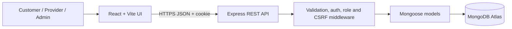
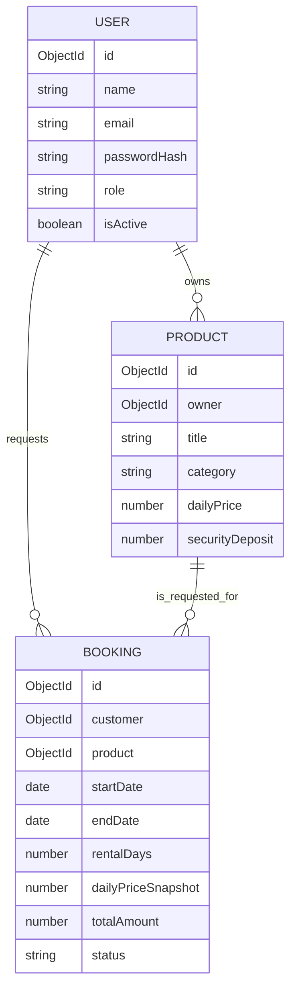

# Rentix — Project Report

> **Academic draft:** Add your name, roll number, institution, guide information, screenshots, and observed test outcomes where indicated. This report describes the current code, not a deployment or test result that has not been observed.

## 1. Project abstract

Rentix is a web-based rental marketplace for sharing access to consumer goods. A customer can browse products, filter listings, select rental dates, and submit a booking request. A provider can publish and maintain listings and accept or reject requests. An administrator can inspect basic marketplace statistics and moderate accounts or listings.

The client uses React and Vite. The server uses Node.js and Express and exposes a JSON REST API. Mongoose models persist users, products, and bookings in MongoDB. Passwords are hashed with bcrypt, sessions use JWTs in HTTP-only cookies, and role checks protect privileged routes. Booking totals are calculated by the server and stored as snapshots. Checkout is a demonstration only and does not handle real card details or payments.

**Student:** [Add name and roll number]  
**Institution / department:** [Add institution and department]  
**Project guide:** [Add guide name]  
**Academic year:** [Add academic year]

## 2. Problem statement

Many consumer goods are purchased for short or occasional use and then remain idle. Purchasing every item can increase cost and storage needs. At the same time, people who own useful items may not have a simple way to offer them to nearby users. The project explores a digital workflow that connects local product providers with customers who need temporary access.

## 3. Project objectives

1. Provide a searchable, category-based consumer goods catalogue.
2. Allow customers and providers to create accounts and sign in securely.
3. Let providers create, edit, deactivate, and remove their own listings.
4. Let customers request a product for validated rental dates.
5. Calculate rental duration and totals on the server and preserve historical price snapshots.
6. Prevent a provider from confirming overlapping bookings through the normal application workflow.
7. Provide role-protected customer, provider, and administrator screens.
8. Document setup and deployment using MongoDB Atlas, Render, and Vercel.

## 4. Scope

The implemented scope includes product discovery and filtering, customer/provider registration, cookie-based login, provider listing management, pending rental requests, provider approval/rejection, eligible customer cancellation, an administrator overview, sample products, responsive layouts, and deployment instructions.

Checkout is not a payment system. A successful request creates a `pending` booking with `demo_unpaid` payment status. The interface labels the total as a demo total and no payment credentials are requested.

## 5. Existing system and limitations

Traditional access may depend on purchasing an item, borrowing informally from acquaintances, or finding rental providers through separate channels. Informal arrangements can make availability, price, and return dates difficult to track. This project provides a central marketplace workflow, but it does not claim that every existing rental service has these limitations.

The current application does not implement identity checks, ratings, provider payout, delivery, messaging, real payment/refund processing, dispute management, or automated notifications. Availability is managed through booking requests and a listing-level available/unavailable status.

## 6. Proposed system

Rentix separates the browser interface, REST API, and persistent database:



The user interface provides public browsing and account-specific dashboards. The API validates inputs, checks session identity and role, calculates rental totals, and calls Mongoose models. MongoDB stores durable user, product, and booking records.

## 7. Technology stack and justification

| Technology | Use in Rentix |
|---|---|
| HTML5, CSS3, JavaScript | Browser markup, styling, and application logic |
| React | Reusable components, routed pages, and shared authentication state |
| Vite | Development server and production frontend build |
| Node.js | JavaScript runtime for the API |
| Express.js | REST routes and middleware |
| MongoDB Atlas | Persistent document database |
| Mongoose | Schemas, validation, references, timestamps, indexes, and transactions |
| bcryptjs | Password hashing |
| JSON Web Token | Signed, short-lived server session stored in an HTTP-only cookie |
| Lucide React | Lightweight interface icons |

JavaScript is used throughout, as required by the project brief.

## 8. MongoDB collections and relationships

### User

The user document contains a name, normalized unique email, `passwordHash`, role (`customer`, `provider`, or `admin`), optional phone, active flag, and timestamps. Password hashes are excluded from normal query results. Public registration permits customer/provider roles only.

### Product

A product contains a title, description, category, image URL array, daily price, security deposit, condition, optional location, owner reference, availability status, active flag, an internal booking version, and timestamps. Category, owner, price, availability, and creation fields are indexed for marketplace queries.

### Booking

A booking references one customer and one product. It stores UTC start/end dates, rental days, daily price snapshot, subtotal, deposit, total, booking status, payment status, and timestamps. Query indexes support customer history and product/status/date conflict lookups.



## 9. REST API workflow

The API is versioned under `/api/v1`. The browser makes JSON requests with credentials enabled. Public routes expose login/registration and active listings. Protected customer routes create and inspect bookings. Provider routes list owned products and received requests. Admin routes report counts and manage users/listings.

For booking creation, the server validates the product ObjectId and ISO date-only strings, rejects past or reversed dates and ranges longer than 365 days, loads the current active product, checks for confirmed date conflicts, and calculates the days and amount. The frontend-provided request contains no trusted price or total.

Pagination is used on list endpoints and capped at a maximum of 50 records per page. Product search escapes regular-expression metacharacters and caps the query length.

## 10. Authentication and authorization

At registration, the server validates fields, hashes the password with bcrypt, stores the account, and issues a signed two-hour JWT in an HTTP-only cookie. Login verifies the supplied password against the stored hash. The cookie is marked `Secure` and `SameSite=None` in production and uses local-development cookie settings outside production.

The JWT contains a CSRF nonce. The API returns that nonce after authentication, and the browser keeps it in memory and sends it in `X-CSRF-Token` for state-changing calls. Authentication middleware reads and verifies the cookie, loads an active user, and role middleware limits actions to the permitted account types. Ownership checks prevent providers from changing another provider's listing.

Administrator accounts are provisioned with `ADMIN_EMAIL` and `ADMIN_PASSWORD` in the server environment and the seed script. The public registration endpoint rejects the admin role.

## 11. Rental price calculation and booking conflicts

The return date is exclusive. A rental from `2026-04-10` to `2026-04-13` is three days. The calculation is:

```text
rentalDays = (endDate - startDate) / 86,400,000
subtotal = dailyPriceSnapshot × rentalDays
totalAmount = subtotal + securityDeposit
```

The server snapshots the current daily price and deposit into the booking. It initially assigns `pending` and `demo_unpaid`.

On confirmation, the server opens a MongoDB transaction, updates a shared booking-version field on the corresponding product, queries for a confirmed booking whose interval overlaps the request, and only then marks the request confirmed. Competing confirmations for one product write to the same product record, causing transaction contention and retry/serialization on replica-set MongoDB. Atlas supports transactions. A standalone MongoDB deployment does not; the API fails the confirmation rather than skipping the conflict check.

MongoDB does not provide a direct unique index for arbitrary date-range overlap. Thus the transaction and application logic protect the supported workflow, but this is not a database-native range constraint. It should be re-evaluated for high-concurrency production use and integration-tested against the target Atlas cluster.

## 12. Testing and validation

The server contains Node.js automated unit tests for strict date parsing and rental-day calculation in `server/utils/rentalDates.test.js`. The root `npm test` command runs these tests.

The README contains a manual checklist for registration, authorization, listing CRUD, search/filter, valid and invalid bookings, overlapping confirmation, cancellation, administration, API errors, and deployment. Complete it during the actual demonstration and record observed results here:

| Test date/environment | Scenario | Expected behavior | Observed result |
|---|---|---|---|
| [Fill in] | [Fill in] | [Fill in] | [Fill in] |
| [Fill in] | [Fill in] | [Fill in] | [Fill in] |
| [Fill in] | [Fill in] | [Fill in] | [Fill in] |

**Screenshots to add from your own run:** [Home and browse] · [Product/booking request] · [Provider request management] · [Admin page]  
No deployment result, test count, performance result, or user count is asserted in this draft.

## 13. Deployment procedure

1. Create a MongoDB Atlas cluster and restricted database user; configure network access for the backend host.
2. Deploy `server/` to Render with `npm install` and `npm start`. Configure `MONGODB_URI`, `JWT_SECRET`, `NODE_ENV=production`, and the frontend `CLIENT_ORIGIN`.
3. Deploy `client/` to Vercel with `npm run build`, output folder `dist`, and `VITE_API_URL` pointing to the Render API.
4. Set the exact Vercel domain in Render CORS configuration and verify the HTTPS health endpoint and cookie-backed login.

See the root README for environment variable details, local commands, and deployment troubleshooting.

## 14. Limitations and future enhancements

Current limitations include URL-provided images, no real payments, no identity verification, no ratings, no messaging, no email/push notification, and no delivery or dispute workflow. The admin interface provides basic moderation and counts rather than a full audit system. Booking conflict protection requires transaction-capable MongoDB and has not been stress-tested.

Future enhancements could include secure media uploads, verified provider profiles, a real payment provider with refunds, messaging and notifications, ratings, audit logs, stronger operational monitoring, integration tests against a replica set, and database-native conflict enforcement if supported by a future storage design.

## 15. Conclusion

Rentix demonstrates an explainable rental marketplace workflow using a React frontend, Express API, and MongoDB persistence. It provides protected roles and server-authoritative booking calculations while keeping payment simulation separate from real financial processing. Further testing and operational controls would be required before using it as a commercial rental service.
